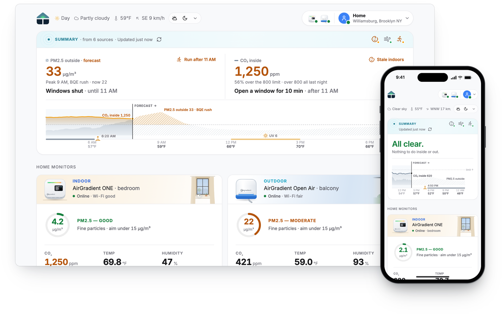
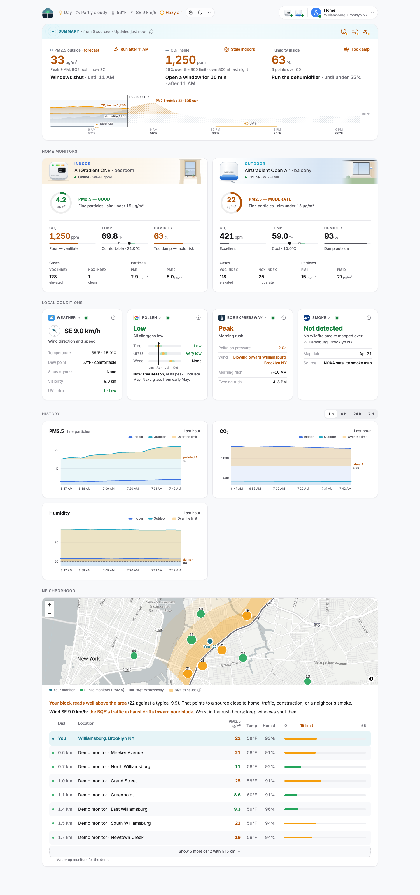

#  Home Air

**Self-hosted, open-source home air quality app for AirGradient monitors.** It shows your readings next to the weather, pollen, wildfire smoke and traffic, and says when to open the windows, keep them shut or go for a run. It runs in the browser on a computer or phone, and includes an MCP server and a skill for Claude, ChatGPT and coding agents.

**[Try the demo](https://homeair.app)** · [Installation](#installation) · [Features](#features) · [How it works](#how-it-works)

<p align="center">
  <picture>
    <source media="(prefers-color-scheme: dark)" srcset="docs/hero-dark.png">
    
  </picture>
</p>

## Installation

You need one or two AirGradient monitors (indoor, outdoor or both). Home Air reads them on your Wi-Fi: no account needed.

**With a coding agent** (Claude Code or Codex). Open your agent anywhere and paste:

```
Set up Home Air for my home by following the instructions here: https://raw.githubusercontent.com/sguyon/homeair/main/SETUP.md
```

Home Air installs in a `homeair` folder where you open the agent (or `~/homeair` if that's inside another project). To choose another folder, name it in the prompt.

The agent finds your monitors and opens your page, then asks a few questions about your home, most of them optional, and offers to add the skill for your coding agents. To run it on a home server (Docker) or a hosted server (Railway, for example): [DEPLOYMENT.md](DEPLOYMENT.md).

**AI assistants:** ask Claude, ChatGPT and other agents about the air at home, and they answer from your monitors. Coding agents use Home Air's skill, other assistants its MCP server ([how](docs/agents.md)); claude.ai and ChatGPT need Home Air with remote access, at an HTTPS address.

## Features

- **Actions** for CO₂ and humidity inside, PM2.5 and pollen outside: "Open a window for 10 min", "Keep windows shut", each with its reason.
- **Timing:** "Keep windows shut until 11 AM", "Run after 11 AM", from a PM2.5 forecast fitted to your outdoor monitor, or to the public ones nearby when there are some.
- **Alerts on your phone:** the actions above as web push notifications, for CO₂, humidity, PM2.5 and pollen ([setup](docs/optional.md#alerts-on-your-phone))
- **Profiles:** pick the ones that match your home (a toddler, someone with sinus allergies, a runner); the page says whether the air suits each of them.
- **More sources:** weather, pollen, wildfire smoke, nearby public monitors (is bad air regional or just around your home?), and a highway's exhaust when the wind blows it your way
- **Road exhaust on the map:** the main roads within 1 km, found during setup (US), each with where its exhaust goes now: likely to reach you, or carried away, and until when ([how](docs/roads.md#what-the-map-shows)).
- A live sky behind the page, with the real sun, clouds and rain. Useless, but my toddler's favorite feature :)
- Installs on your phone's home screen like an app (a PWA): Share › Add to Home Screen (iPhone) or ⋮ › Install app (Android)

## Why I built it

AirGradient's dashboard shows my two monitors' readings well, but not what to do about them, and the rest lives in other apps: the weather, the pollen season, rush hour on the expressway nearby. I wanted one page that says what to do, for my household (a toddler's sleep, sinus allergies, running), without hundreds of clicks to build my own dashboard: a coding agent sets it up in a few minutes.

- **Minimal on purpose, and by necessity:** I built it around what my own two monitors measure :)
- **Plain rules you can read,** not a model: each action says why.
- **Easy to extend with a coding agent:** [AGENTS.md](AGENTS.md) explains the code, and [docs/optional.md](docs/optional.md#adding-a-profile) how to add a profile.
- **Ask your AI assistant:** with the skill or the MCP server, Claude, ChatGPT or your coding agent answer from your readings, follow-up questions too ("how was the air last night?").

## Limitations

- **Works best in the US:** smoke, pollen and the forecast links use US sources. Elsewhere, turn them off in `config.toml`; the rest works.
- **One or two monitors:** one indoor, one outdoor, or both. With one, outdoor PM2.5 comes from public monitors nearby. No rooms yet.
- **Wi-Fi reads need the same network** and firmware 3.1.4 or newer; from Docker, setup finds the monitors first.
- **Road coverage:** during setup, Home Air finds nearby roads from a built area's file. The road data is the [`data-v1`](https://github.com/sguyon/homeair/releases/tag/data-v1) release. See [Roads near your home](docs/roads.md) for coverage, timing and downloads.

## Data and privacy

- **Your readings stay on your computer:** Home Air keeps its own history in `history.sqlite`, next to `config.toml`, until you delete it, and never sends it anywhere. Home Air on a hosted server (Railway, for example) keeps none (its charts come from AirGradient's cloud).
- **What leaves:** during setup, one lookup sends your typed address to OpenStreetMap's Nominatim (or the coordinates you supply instead, rounded to four decimal places, to look up the place name). Home Air sends the rounded place (two decimal places, about 1 km) to Open-Meteo for the timezone when needed, and a widened box around the rounded place to AirGradient's public map when selecting an outdoor source. Home Air filters and ranks those monitors from the exact place on this computer. During setup's config check, AirGradient can also receive a second box around the rounded place and, if the selected public monitor is absent from that box, its ID for place and current-reading requests. Road-data file names reveal the selected area; the configured data host receives the requested file name and the requesting IP address; a host reached through a download redirect receives the redirect URL and the requesting IP address. The default host is GitHub, whose release downloads can redirect to `release-assets.githubusercontent.com`. While Home Air runs, the place sent for weather, pollen and the map is also rounded: Open-Meteo, Google (with a pollen key) and AirGradient's public map. The page receives the rounded place and the saved pollen ZIP when set; opening its pollen.com link sends that ZIP to pollen.com. The separate `./homeair check --suggest` can send an area around the exact saved coordinates when suggesting a source; checking an indoor-only home's saved outdoor source uses the rounded place ([details](docs/roads.md#privacy)). For monitor lookups, Home Air sends your token only to AirGradient; `./homeair railway` also sends saved settings and keys, including that token, to Railway. Reading monitors on the Wi-Fi sends nothing out. How often it calls AirGradient: [docs/api-usage.md](docs/api-usage.md).
- **No accounts, no analytics:** logs list the sources called, never readings or keys. Only the public demo site counts visits (Vercel Web Analytics, no cookies).

## How it works

The actions are fixed rules, not a model: each compares a reading with a limit you can change in `config.toml`. The default thresholds: CO₂ 800 ppm inside, PM2.5 15 µg/m³ outside (35 for "high"), humidity 30–60% inside, pollen 3 of 5. Why these numbers, how the PM2.5 forecast is fitted to your monitor, and which corrected PM2.5 values the rules use: [docs/how-it-works.md](docs/how-it-works.md).

## Screenshots

<p align="center">
  
</p>

## Credits

- Nearby monitors: [AirGradient](https://www.airgradient.com) community monitors ([API](https://api.airgradient.com/public/docs/api/v1/), [public map](https://www.airgradient.com/map/)), licensed under [CC-BY-SA 4.0](https://creativecommons.org/licenses/by-sa/4.0/).
- Weather and the PM2.5 forecast: [Open-Meteo](https://open-meteo.com) ([Weather API](https://open-meteo.com/en/docs), [Air Quality API](https://open-meteo.com/en/docs/air-quality-api)).
- Pollen: [Google Pollen API](https://developers.google.com/maps/documentation/pollen) (optional, needs a key).
- Wildfire smoke: NOAA's [Hazard Mapping System](https://www.ospo.noaa.gov/products/land/hms.html).
- Map: [MapLibre](https://maplibre.org), with tiles from [OpenFreeMap](https://openfreemap.org) and map data from [OpenStreetMap](https://www.openstreetmap.org/copyright) contributors.
- Device frame in the link-preview images: [Devices.css](https://github.com/picturepan2/devices.css) (MIT, `scripts/vendor/`).

## Contributing

Questions, bugs and ideas are welcome as GitHub issues. Never paste a token or key in an issue or pull request, even a partial one. To report a security problem, see [`SECURITY.md`](SECURITY.md).

Pull requests: install `requirements-dev.txt` (`pip install -r requirements-dev.txt`), run `pytest -q` and `node --test tests/*.test.mjs` first, and keep your `config.toml`, `.env` and readings out of the diff. Agents working on the code read [`AGENTS.md`](AGENTS.md). To run the demo locally: `DEMO=1 uv run --with-requirements requirements.txt server.py`, then http://localhost:5555.

## License

[MIT](LICENSE)
